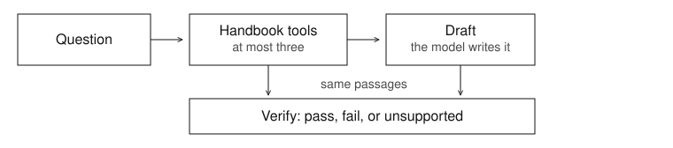

# Jakob Alex

Berlin. I build tools that answer from a document you can open, then show whether each claim holds.

The model writes the draft. I decide which documents it may use, how many lookups it gets, and what counts as pass, fail, or a refusal.

## Selected work

### [CiteBot](https://github.com/jakob-alexander2000/citebot)

Ask one employee handbook a question, and read the check under the answer.

A citation can name the right page while the sentence says something that page does not. The citation has to mean what the passage means.

[Try it](https://citebot-chi.vercel.app). The fixed questions, and what a pass requires, are on [the evals page](https://citebot-chi.vercel.app/evals).

<picture>
  <source media="(prefers-color-scheme: dark)" srcset="assets/citebot-verify-dark.svg">
  
</picture>

The model drafts from the passages it just retrieved. I keep every lookup inside that handbook, stop at three, and score each claim against those same passages. A straight refusal counts as pass when the page does not say it. In the source, `npm run eval` runs that check with no key.

### [citebot-evals](https://github.com/jakob-alexander2000/citebot-evals)

Score a fixed set of CiteBot handbook questions, with no model and no network.

A check you cannot repeat is only a story.

```bash
git clone https://github.com/jakob-alexander2000/citebot-evals.git
cd citebot-evals
npm install
npm run eval
```

I set the cases: the fact an answer must state, the file it must cite, and the questions that must refuse or correct a false premise. The command replays saved replies. A live call to CiteBot is optional and is not the gate.

### [Desk](https://github.com/jakob-alexander2000/desk)

Ask a folder of notes on your machine. The answer names the files it used.

Notes that already live on disk should not have to be pasted into a chat product first.

```bash
git clone https://github.com/jakob-alexander2000/desk.git
cd desk
npm install
export GEMINI_API_KEY=your_key
npm run desk -- ask ./sample-notes "What is Desk?"
```

A page on this machine only: `npm run desk -- ui ./sample-notes`, then open `http://127.0.0.1:3847`.

The model writes the answer. I choose the passages on disk by word overlap, require the file and line range in the sources, and ship a command line plus that localhost page. This version does not package a desktop app.

### [desk-index](https://github.com/jakob-alexander2000/desk-index)

Rank the Markdown in a folder. No model on this path.

The lookup is sometimes the whole product.

```bash
git clone https://github.com/jakob-alexander2000/desk-index.git
cd desk-index
go test ./...
go run ./cmd/desk-index search -dir ./sample-notes "core hours"
```

The same index can listen on this machine: `go run ./cmd/desk-index -dir ./sample-notes -addr 127.0.0.1:8080`.

I keep the index in memory, score a file by how often the query words appear and how rare they are in the folder, and depend only on the Go standard library.

<!--
SELECTED WORK PLACEHOLDER
retrieval-autopsy and style-distance stay off this page until Jakob approves them.
Do not add a link, a pin, or any rendered text for either repository before that.
When one is approved, insert it below desk-index in the same shape as the entries above:
one idea, the problem, a live link or a one-command run, and one line on what the model did versus what Jakob decided.
-->
